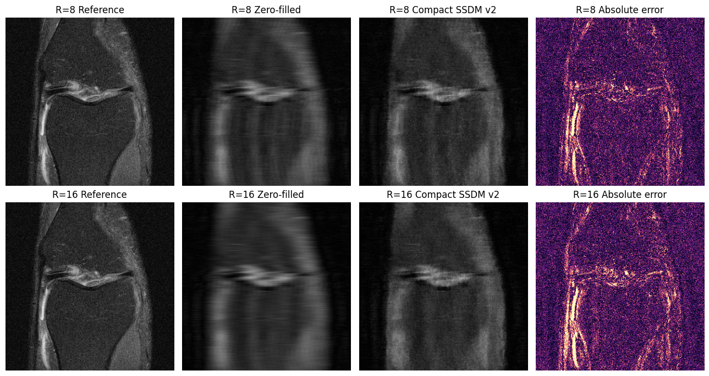

# 축소 SSDM을 이용한 가속 MRI 재구성 비교

박지성의 개인 학습 실습. 2026년 10월 실행 기록을 2026-11-03에 정리했다.

## 목적과 방법
320×320 MRI, 8성분 축소 모델을 사용해 zero-filled 복원과 SSDM 기반 복원을 비교했다. 초기 900-update 실험 후 CDL 추가 학습·확산 모델 학습·샘플러 선택을 진행했다. 개선 실행 로그에서 6000 updates 저장 상태와 평가에 선택된 3000-update 체크포인트를 구분한다. 검증 4개 영상에서 sampler3를 선택한 뒤 별도 최종 16개 영상에 R8/R16을 적용했다.

## 결과
| R | 방법 | n | PSNR | SSIM | MAE |
|---|---|---|---|---|---|
|8|zero-filled|16|22.969293|0.440291|0.052154|
|8|축소 SSDM|16|22.892082|0.404317|0.053688|
|16|zero-filled|16|22.562988|0.395169|0.054191|
|16|축소 SSDM|16|22.296768|0.345873|0.056800|

최종 평균 PSNR 차이는 R8 -0.0772dB, R16 -0.2662dB였다. PSNR 개선 사례는 각각 7/16, 4/16이었다. 이번 조건에서 평균 성능 향상은 확인되지 않았다. 논문 성능 재현이나 임상 검증 완료를 주장하지 않는다. 코드의 paper_reproduction 플래그도 false이다.

## 역할과 학습
사용자는 의료영상 진로에 맞는 실습 방향과 정리·공개를 선택했다. 구현·학습 재개·검증·웹 정리는 AI 보조를 활용했다. 기준 복원과의 비교, 검증/최종 평가 분리, 체크포인트 고정의 필요성을 확인했다. 다음 단계는 손실과 정규화, 샘플링 조건을 한 번에 하나씩 바꿔 원인을 분석하는 것이다.

## 파일과 재실행 조건
출력 포함 노트북, 실제 셀 출력에서 추출한 비교 그림 2개, 실행 로그, 로그의 6자리 표를 옮긴 CSV를 제공한다. 새 학습을 재실행하지 않았으며 공개 전 저장된 결과를 점검했다. 구현 ZIP과 두 모듈은 노트북의 SHA256과 일치함을 확인했다.

Colab GPU와 원래 Drive의 SSDM320_full_run 폴더가 필요하다. 노트북 첫 셀의 ZIP, ssdm_compact.py, ssdm_drive_lazy.py, ssdm_improve_v2.py를 해당 Drive 폴더에 두고 데이터·체크포인트 경로를 구성해야 한다. 이 저장소에는 원시 MRI 데이터와 대용량 가중치가 포함되지 않아 단독 전체 재실행은 불가능하다. 데이터 이용 조건과 원 논문/라이브러리 고지는 구현 소스 및 원 데이터의 조건을 따른다. 공개 노트북의 결과 열람에는 GPU가 필요하지 않다.

원본 Colab https://colab.research.google.com/drive/1e_WvIatL6WHsgExsBqJkcjDJ9IrxBPue

## 참고 자료
- SSDM 논문 https://proceedings.mlr.press/v315/deng26a.html
- DDS 기반 구현 https://github.com/hyungjin-chung/DDS/tree/509b140ee8ba76772ab7d98929270033d4306f2f
- fastMRI 데이터 https://fastmri.med.nyu.edu/ (원 데이터 접근·이용 조건 확인 필요)
- 소스 ZIP 내부 README와 라이선스 고지를 함께 확인한다.
