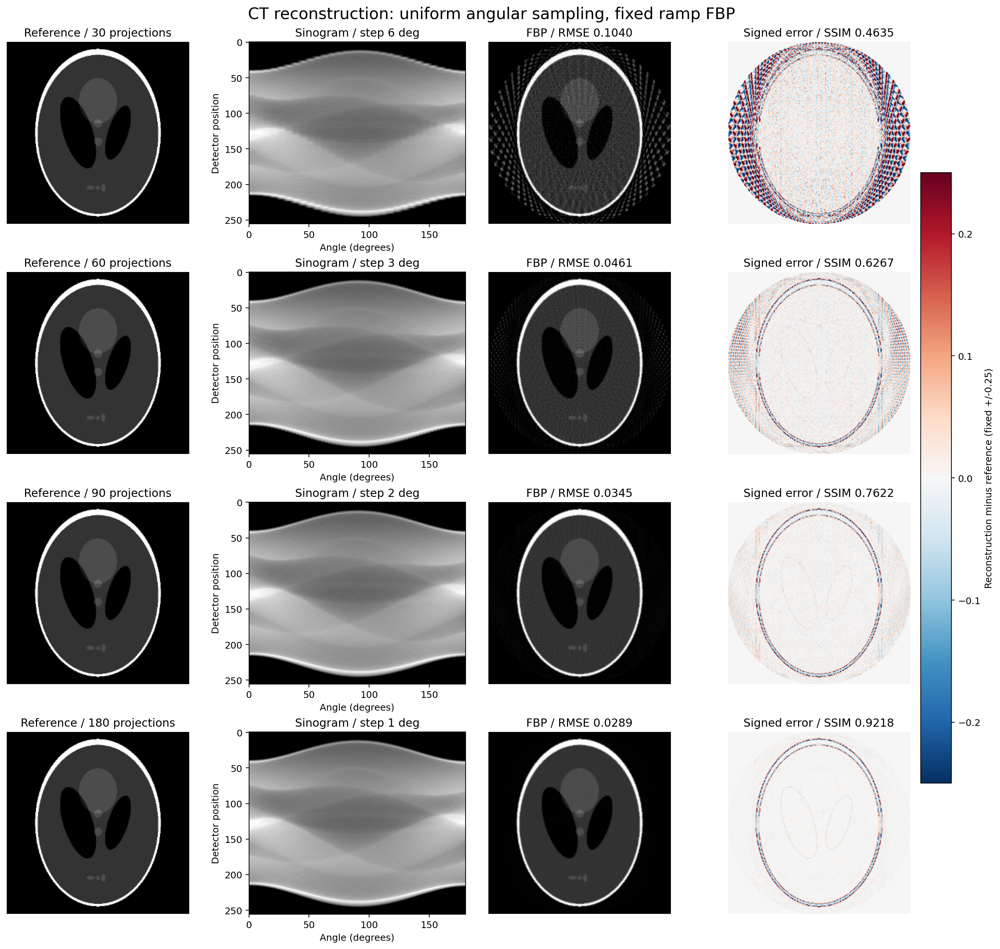
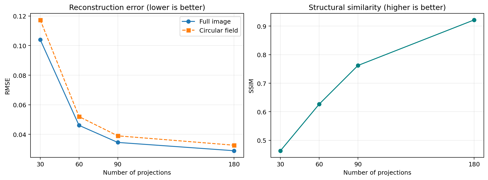

# CT 촬영 각도 수에 따른 재구성 품질 비교

박지성 · 바이오메디컬공학 · 개인 학습 실습 · 2026-10-24 기본 실험 완료

## 목적과 방법
0–180° 각도 범위를 고정하고 투영 개수 30/60/90/180개를 비교한다. 256×256 Shepp–Logan 팬텀에 평행빔 Radon 변환을 적용한 뒤 ramp 필터 FBP로 복원한다. 추가 잡음은 없다. 원본과 복원값을 조건별로 정규화하거나 클리핑하지 않는다. 이미지 표시만 0–1, 오차 표시는 ±0.25로 고정한다.

## 실행
Colab에서 `ct-angle-comparison.ipynb`를 열고 위에서부터 모두 실행한다. GPU는 필요하지 않다. 결과는 런타임의 `ct_angle_comparison_outputs/` 및 ZIP으로 생성되므로 세션 종료 전에 다운로드한다.

로컬 실행: Python 환경에서 `python -m pip install -r requirements.txt` 후 이 폴더에서 `python run_experiment.py`. PNG/CSV/JSON/NPZ/Markdown과 ZIP이 생성된다. 이 저장소의 `results/`는 실제 Colab 실행 결과이며 로컬 재실행 결과는 별도 생성 폴더에 저장된다.

## 결과
| 투영 개수 | 전체 RMSE | 전체 SSIM | 원형 시야 RMSE |
|---:|---:|---:|---:|
| 30 | 0.103957 | 0.463478 | 0.117349 |
| 60 | 0.046081 | 0.626668 | 0.052018 |
| 90 | 0.034536 | 0.762179 | 0.038985 |
| 180 | 0.028925 | 0.921829 | 0.032651 |

30→180개에서 전체 RMSE는 약 72.18% 감소했다. 투영이 적을 때 나타나는 줄무늬 아티팩트가 줄어들었으나, 180개에서도 경계 주변 오차가 남는다. 이 팬텀과 복원 조건에서 얻은 결과다.

## 역할·AI 활용
사용자는 의료영상 진로에 맞는 프로젝트를 요청하고 이 비교 실습을 선택했다. 코드 작성·실행·결과 추출·웹 통합은 Codex의 도움으로 수행했다. 본인이 직접 코드를 전부 작성하거나 임상 검증을 수행한 것으로 표시하지 않는다. 조건 선택의 이유와 결과 해석을 본인이 검토하고 설명하는 것이 다음 학습 단계다.

## 검증과 한계
4개 복원 결과의 크기·유한값을 검사했다. 다운로드한 NPZ 배열로 전체 RMSE 4개를 독립 재계산해 CSV와 일치함을 확인했다. 오류 출력이 없는 실행 노트북과 결과 PNG를 확인했다. 환경은 `results/experiment_config.json`에 기록되어 있다.

가상 2D 평행빔 팬텀, 잡음 없음, 단일 복원 방법에 한정된다. 실제 CT 선량·환자 영상·임상 성능을 입증하지 않는다. 전체 SSIM에는 원형 시야 밖의 0 영역이 포함된다. 다음 실험은 고정 시드의 투영 잡음과 ramp/hann 필터 비교다.

## 출처
- [scikit-image 공식 Radon/FBP 예제](https://scikit-image.org/docs/stable/auto_examples/transform/plot_radon_transform.html)
- [scikit-image 라이선스](https://github.com/scikit-image/scikit-image/blob/main/LICENSE.txt)
- Shepp–Logan 팬텀은 scikit-image 제공 데이터를 사용했다. 공식 예제를 참고해 비교 조건·정량 검증·고정 표시 범위·결과 저장을 구성했다.

원본 Colab: https://colab.research.google.com/drive/1pYaIIjSZDvUuoQeGRUSMaOdF8hNRxeE4
공개 열람은 이 저장소의 실행 결과 포함 노트북을 사용한다.
